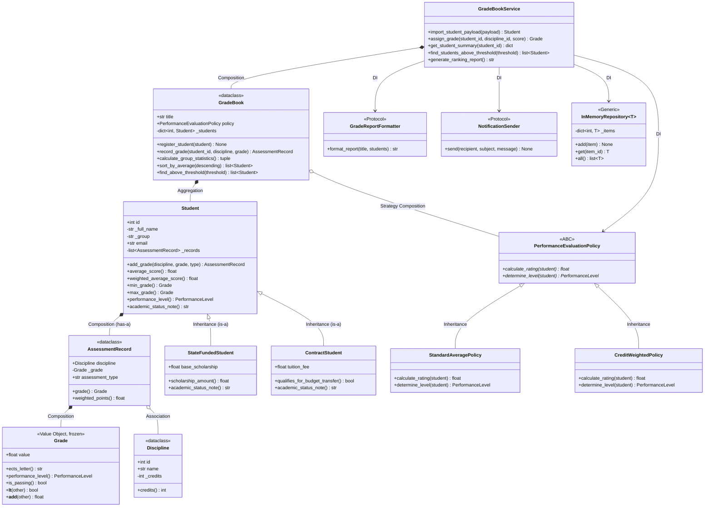

# Лабораторна робота №4 — Професійне ООП та система типів Python

**Варіант 7:** Система оцінювання студентів (`Student`, `Discipline`, `Grade`, `AssessmentRecord`, `GradeBook`)

---

## 1. Мета роботи

Сформувати практичні навички побудови професійної об'єктно-орієнтованої моделі в Python із використанням класів, композиції, наслідування, абстрактних базових класів (`ABC`), структурних протоколів (`Protocol`), `dataclass`, `properties`, `dunder`-методів, принципів **SOLID** та сучасної системи анотацій типів (`TypeVar`, `Generic`, `TypedDict`) із перевіркою статичним аналізатором типів (`mypy`).

---

## 2. Опис предметної області та Domain Entities (Варіант 7)

Предметна область охоплює автоматизацію обліку навчальних досягнень студентів закладу вищої освіти: реєстрацію студентів (бюджетної та контрактної форм навчання) і навчальних дисциплін, виставлення та оновлення оцінок за 100-бальною шкалою та шкалою ECTS, обчислення середнього, середньозваженого, мінімального і максимального балів, визначення рівня академічної успішності, ранжування студентів, пошук студентів вище заданого порога успішності, генерацію відомостей і розсилку сповіщень.

### Основні сутності та об'єкти моделі:
1. **`Grade`** ([value_objects.py](src/grade_system/value_objects.py)) — незмінний об'єкт-значення (`@dataclass(frozen=True, slots=True)`), що інкапсулює числову оцінку `0..100`, букву ECTS (`A`–`F`), рівень успішності (`PerformanceLevel`) та підтримує порівняння (`@total_ordering`, `__lt__`) і додавання (`__add__`).
2. **`PerformanceLevel`** ([value_objects.py](src/grade_system/value_objects.py)) — перелік (`Enum`) рівнів успішності: `EXCELLENT`, `GOOD`, `SATISFACTORY`, `UNSATISFACTORY`.
3. **`Discipline`** ([models.py](src/grade_system/models.py)) — навчальна дисципліна (`@dataclass(slots=True)`) з валідованою властивістю `credits` (кредити ECTS).
4. **`AssessmentRecord`** ([models.py](src/grade_system/models.py)) — запис про оцінювання студента з дисципліни (`@dataclass(slots=True)`), що поєднує `Discipline` та `Grade` і обчислює кредитно-зважений бал (`weighted_points`).
5. **`Student`** ([models.py](src/grade_system/models.py)) — базова доменна сутність студента, яка інкапсулює список `AssessmentRecord` та надає властивості `average_score`, `weighted_average_score`, `min_grade`, `max_grade`, `has_academic_debt`, `performance_level`.
6. **`StateFundedStudent`** та **`ContractStudent`** ([models.py](src/grade_system/models.py)) — спеціалізовані підкласи `Student`, що використовують `super().__init__()` і реалізують поліморфну поведінку розрахунку стипендії (`scholarship_amount`) або права переведення на бюджет (`qualifies_for_budget_transfer`).
7. **`GradeBook`** ([models.py](src/grade_system/models.py)) — контейнерний клас журналу оцінок (`@dataclass`), який агрегує студентів та політику оцінювання (`PerformanceEvaluationPolicy`), реалізує статистику, сортування та пошук студентів вище порога.
8. **`PerformanceEvaluationPolicy` (`ABC`)** ([models.py](src/grade_system/models.py)) — абстрактна стратегія обчислення рейтингу та рівня успішності з конкретними реалізаціями `StandardAveragePolicy` та `CreditWeightedPolicy`.
9. **`HasId`, `Serializable`, `GradeReportFormatter`, `NotificationSender` (`Protocol`)** ([protocols.py](src/grade_system/protocols.py)) — структурні інтерфейси для репозиторію, серіалізації, форматування звітів та надсилання сповіщень.
10. **`InMemoryRepository[T]` (`Generic[T]`)** ([repositories.py](src/grade_system/repositories.py)) — узагальнене сховище даних у пам'яті з `TypeVar("T", bound=HasId)`.
11. **`StudentPayload`, `AssessmentPayload` (`TypedDict`)** ([dto.py](src/grade_system/dto.py)) — типізовані словники для прийому зовнішніх JSON-подібних даних.
12. **`GradeBookService`** ([services.py](src/grade_system/services.py)) — сервіс прикладного рівня (Application Service), побудований на основі Dependency Injection.

---

## 3. Діаграма класів (Class Diagram)



---

## 4. Пояснення ключових архітектурних рішень

### 4.1. Наслідування (Inheritance) vs Композиція (Composition)
* **Наслідування (`is-a`)** застосовано там, де є справжня спеціалізація сутності:
  * `StateFundedStudent(Student)` та `ContractStudent(Student)` розширюють базовий клас `Student` через `super().__init__(...)` і перевизначають метод `academic_status_note()`.
  * `StandardAveragePolicy` та `CreditWeightedPolicy` успадковують абстрактний базовий клас `PerformanceEvaluationPolicy(ABC)`.
* **Композиція (`has-a`)** є основним способом побудови поведінки:
  * `Student` містить закритий список записів `_records: list[AssessmentRecord]`.
  * `AssessmentRecord` складається з `Discipline` та незмінного `Grade`.
  * `GradeBook` містить стратегію `PerformanceEvaluationPolicy`, яку можна змінити без модифікації коду журналу.
  * `GradeBookService` отримує через конструктор (`Dependency Injection`) репозиторії `InMemoryRepository[Student]`, `InMemoryRepository[Discipline]`, політику `PerformanceEvaluationPolicy`, форматер звіту `GradeReportFormatter` та сервіс сповіщень `NotificationSender`.

### 4.2. Інкапсуляція та Properties
* У класі `Discipline` атрибут `_credits` захищений від некоректних змін: читання та запис відбуваються через `@property def credits` та `@credits.setter`, який забороняє значення `<= 0`.
* У класі `Student` список оцінок зберігається у приватному атрибуті `self._records`, а назовні через `@property def records` повертається незмінний кортеж `tuple[AssessmentRecord, ...]`, щоб зовнішній код не міг напряму мутувати внутрішній список в обхід методу `add_grade()`.

### 4.3. Dataclass та Immutable Value Object
* `Grade` оголошено як `@dataclass(frozen=True, slots=True)`: після створення оцінку неможливо змінити (`frozen=True`), а у `__post_init__` перевіряється інваріант `0.0 <= value <= 100.0`.
* `Discipline`, `AssessmentRecord` та `GradeBook` використовують `@dataclass` (включно з `field(default_factory=...)` для безпечної ініціалізації змінюваних колекцій).

### 4.4. Абстрактні базові класи (`ABC`) та Протоколи (`Protocol`)
* **`ABC` (номінальна типізація):** `PerformanceEvaluationPolicy(ABC)` визначає обов'язкові методи `@abstractmethod calculate_rating()` та `determine_level()`. Створити екземпляр `PerformanceEvaluationPolicy` напряму неможливо.
* **`Protocol` (структурна типізація):** `GradeReportFormatter`, `NotificationSender`, `HasId` та `@runtime_checkable Serializable` дозволяють передавати у `GradeBookService` будь-які об'єкти (`MarkdownReportFormatter`, `ConsoleNotificationSender`), які мають відповідні сигнатури методів, без необхідності явного наслідування.

### 4.5. Перевизначені Dunder-методи
У проєкті реалізовано **7 різних dunder-методів**:
1. `__post_init__` (`Grade`, `Discipline`) — перевірка доменних інваріантів під час ініціалізації;
2. `__str__` (`Grade`, `Discipline`, `AssessmentRecord`, `Student`) — людиночитабельне представлення;
3. `__repr__` (`Student`, `@dataclass`) — налагоджувальне представлення об'єкта;
4. `__len__` (`Student`, `GradeBook`, `InMemoryRepository`) — кількість оцінок у студента або студентів у журналі;
5. `__iter__` (`Student`, `GradeBook`, `InMemoryRepository`) — ітерація по записах або студентах;
6. `__contains__` (`Student`, `GradeBook`, `InMemoryRepository`) — оператор `in` за ID дисципліни чи студента;
7. `__getitem__` (`GradeBook`), `__lt__` та `__add__` (`Grade`) — індексація журналу `grade_book[student_id]`, порівняння та сума оцінок.

### 4.6. Принципи SOLID та Dependency Injection
1. **SRP (Single Responsibility Principle):** `Grade` відповідає лише за правила оцінки, `Student` — за облік власних оцінок, `GradeBook` — за агрегацію та ранжування групи, `MarkdownReportFormatter` — за форматування таблиці звіту, `ConsoleNotificationSender` — за доставку повідомлень, а `GradeBookService` — за координацію сценаріїв використання (use cases).
2. **OCP (Open/Closed Principle):** для додавання нової формули рейтингу достатньо створити новий підклас `PerformanceEvaluationPolicy` (наприклад, `CreditWeightedPolicy`) без редагування `GradeBook` чи `GradeBookService`.
3. **LSP (Liskov Substitution Principle):** екземпляри `StateFundedStudent` та `ContractStudent` повністю взаємозамінні з базовим типом `Student` у всіх колекціях, репозиторіях та звітах.
4. **ISP (Interface Segregation Principle):** замість одного монолітного інтерфейсу створено вузькі протоколи `HasId`, `Serializable`, `GradeReportFormatter` та `NotificationSender`.
5. **DIP (Dependency Inversion Principle):** `GradeBookService` залежить від абстракцій (`PerformanceEvaluationPolicy`, `GradeReportFormatter`, `NotificationSender`), які передаються ззовні через конструктор (**Dependency Injection**), що робить сервіс легким для модульного тестування.

### 4.7. Система типів: `Generic`, `TypeVar`, `TypedDict`
* **Bound `TypeVar` та `Generic[T]`:** `T = TypeVar("T", bound=HasId)` дозволяє використовувати `InMemoryRepository[Student]` та `InMemoryRepository[Discipline]` із повною статичною перевіркою типів.
* **Constrained `TypeVar`:** `NumericScore = TypeVar("NumericScore", int, float)` використовується у функції `scale_score()`.
* **`TypedDict`:** `StudentPayload` та `AssessmentPayload` (із полем `NotRequired`) описують структуру сирих зовнішніх словників до їх конвертації у доменні об'єкти функцією `student_from_payload()`.

---

## 5. Структура проєкту

```text
Lab_4/
├── pyproject.toml
├── README.md
├── src/
│   └── grade_system/
│       ├── __init__.py
│       ├── dto.py
│       ├── main.py
│       ├── models.py
│       ├── protocols.py
│       ├── repositories.py
│       ├── services.py
│       └── value_objects.py
└── tests/
    └── test_grade_system.py
```

---

## 6. Експеримент зі статичною перевіркою типів (`mypy`)

Згідно з п. 71 методичних вказівок було проведено обов'язковий експеримент із навмисним внесенням 3 помилок типізації:

1. **Error 1 (Несумісність типу змінної):**
   ```python
   student_id: int = "101"
   ```
   *Діагностика `mypy`:* `error: Incompatible types in assignment (expression has type "str", variable has type "int") [assignment]`
2. **Error 2 (Невірний тип повернення функції):**
   ```python
   def get_total_credits() -> int:
       return "18"
   ```
   *Діагностика `mypy`:* `error: Incompatible return value type (got "str", expected "int") [return-value]`
3. **Error 3 (Порушення параметризації `Generic[T]`):**
   ```python
   repo: InMemoryRepository[Student] = InMemoryRepository()
   repo.add(Discipline(id=1, name="ООП", _credits=5))
   ```
   *Діагностика `mypy`:* `error: Argument 1 to "add" of "InMemoryRepository" has incompatible type "Discipline"; expected "Student" [arg-type]`

Після усунення навмисних помилок перевірка `mypy --strict src tests` завершується успішно:
```text
Success: no issues found in 9 source files
```

---

## 7. Запуск програми та тестів

```bash
# Запуск демонстраційного сценарію
PYTHONPATH=src python -m grade_system.main

# Статична перевірка типів у суворому режимі
mypy src tests

# Запуск модульних тестів
pytest
```

---

## 8. Висновок

У ході виконання лабораторної роботи №4 за варіантом 7 було спроєктовано та реалізовано повноцінну типізовану об'єктно-орієнтовану модель системи оцінювання студентів. Застосовано інкапсуляцію стану через `properties`, незмінні об'єкти-значення (`@dataclass(frozen=True, slots=True)`), обґрунтоване наслідування для бюджетної й контрактної форм навчання, композицію для журналу оцінок і сервісного шару, абстрактні класи (`ABC`) для політик розрахунку рейтингу та структурні протоколи (`Protocol`) для форматування звітів і надсилання сповіщень. Використання `Generic[T]`, `TypeVar`, `TypedDict` і статичного аналізатора `mypy` у режимі `strict = true` забезпечило надійну перевірку узгодженості типів ще до виконання програми.
